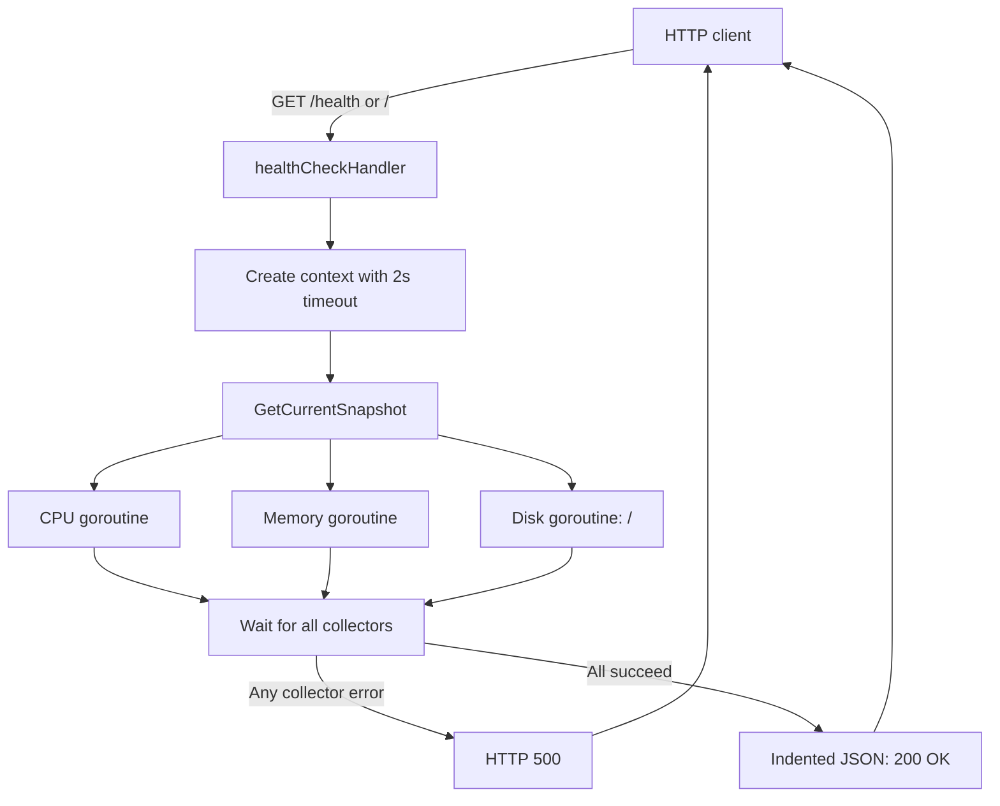
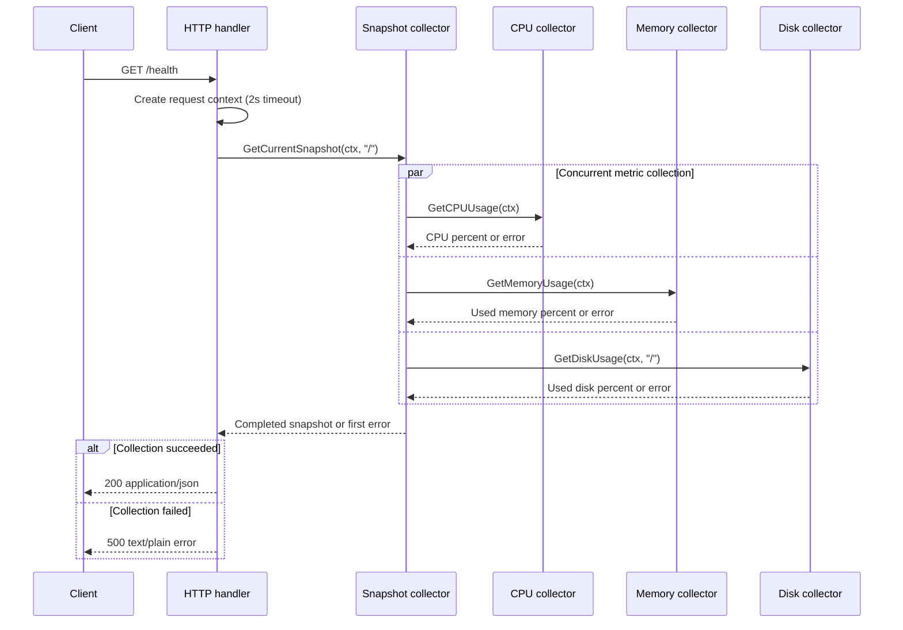

# System Resource Health Check

A small Go HTTP service that reports the host's CPU, memory, and disk usage as JSON. It was built as a technical interview exercise for an infrastructure company.

## Background: The Interview Challenge

I was attending a technical interview with an infrastructure company when I was asked to implement a system-monitoring / resource-health-check service in the programming language of my choice. I chose Go because the challenge was a good opportunity to demonstrate practical concurrency: collecting independent system metrics in parallel with goroutines, while bounding the work for each HTTP request with a context timeout.

This repository is that focused implementation. The service gathers CPU, RAM, and disk usage and exposes the result through a simple HTTP endpoint. The interview prompt also led me to think about the operational trade-offs that matter when turning a small health-check into a production monitoring component; those reflections are included below.

## Why Go?

- **Goroutines and concurrency:** CPU, memory, and disk measurements are independent, so they can be collected concurrently without creating heavyweight threads.
- **Lightweight runtime:** Go's small deployment footprint and straightforward HTTP server make it a natural fit for infrastructure utilities.
- **`gopsutil`:** The project uses `github.com/shirou/gopsutil/v4` to read host CPU, virtual memory, and disk statistics across supported platforms.
- **Context timeouts:** Each request gets a child context with a two-second deadline. The context is passed into the metric collectors so work is bounded and can be cancelled where supported.

## Architecture & Concurrency Model

The HTTP handler creates a request-scoped timeout and asks `GetCurrentSnapshot` to collect three measurements. That method starts one goroutine per metric, waits for all three, and returns the first reported error. On success, the handler serializes the snapshot as JSON.

### Request flow



### Collection sequence



**Concurrency details:** A `sync.WaitGroup` waits for all three workers. The workers write to distinct fields (`CPU`, `RAM`, and `Disk`), and `sync.Once` safely stores the first error encountered. The current implementation waits for all collectors before responding, even if one fails; a future implementation could cancel sibling work on the first error.

## API Documentation

### `GET /health`

Returns a current snapshot of the host's resource usage. The same handler is also registered at `/`, so `GET /` works as an alias. The server currently does not restrict other HTTP methods explicitly; clients should use `GET`.

**Success — `200 OK`**

Content type: `application/json`

```json
{
  "ram_usage_percent": 42.5,
  "disk_usage_percent": 61.3,
  "cpu_usage_percent": 8.7
}
```

All three values are percentages in the range reported by `gopsutil` (normally 0–100). RAM is virtual-memory `UsedPercent`; disk is the used percentage for `/`; CPU is measured over a 200 ms interval.

**Failure — `500 Internal Server Error`**

If any collector returns an error, the handler responds with a plain-text message similar to:

```text
Failed to get system stats: failed to fetch cpu usage: ...
```

The actual error depends on the operating system, permissions, mount configuration, or collection failure. The response reports the first error observed; which worker reports first is not deterministic.

## How to Run

### Prerequisites

- Go installed (use a version compatible with the selected `gopsutil/v4` release).
- Access to the host's system statistics. The disk collector currently checks the `/` mount path, so adapt it for platforms where that path is not appropriate.

### Initialize and install dependencies

This repository's `main.go` imports `gopsutil/v4`. If the repository does not already include a `go.mod`, initialize the module and add the dependency:

```bash
go mod init example.com/system-health-check
go get github.com/shirou/gopsutil/v4
```

If a `go.mod` is already present, simply resolve dependencies:

```bash
go mod tidy
```

### Start the service

```bash
go run .
```

The server listens on `0.0.0.0:8000`. In another terminal, query it:

```bash
curl http://localhost:8000/health
```

The service binds to all network interfaces by default. For local development or production, consider making the bind address configurable and restricting exposure as appropriate.

## Senior Engineering Reflections

The current code is intentionally small and synchronous from the request's perspective. It is useful as an interview-sized demonstration, but a production service would need to make explicit decisions about sampling, failure behavior, lifecycle management, and observability.

1. **Cache or sample metrics on a ticker.** CPU collection takes a 200 ms measurement interval, and collecting on every request means request latency and host load scale with traffic. A background sampler can refresh a thread-safe snapshot periodically; handlers can serve the latest sample quickly. Include the sample timestamp and define how stale data should be represented.
2. **Use `errgroup` for structured concurrency.** `golang.org/x/sync/errgroup` can simplify launching collectors, returning errors, and cancelling sibling work as soon as one collector fails. Keep cancellation behavior clear and verify that each underlying operation respects the context.
3. **Graceful shutdown and server timeouts.** Replace bare `http.ListenAndServe` with an `http.Server` configured with read, write, and idle timeouts. Handle OS signals, call `Shutdown` with a deadline, and avoid `log.Fatalf` in a way that bypasses cleanup.
4. **Preserve floating-point metrics.** These values are `float64`, which retains fractional percentages and is appropriate for monitoring. Avoid rounding or converting them to integers in the collection layer; if presentation rounding is desired, make that an explicit API decision.
5. **Make configuration and platform assumptions explicit.** Configure listen address, disk mount path, sampling interval, and timeout rather than hard-coding them. `/` is the current disk target and may not be the intended mount on every deployment.
6. **Define health semantics.** A resource snapshot is not necessarily a readiness or liveness decision. Add thresholds, status fields, or separate endpoints only if the service needs to make an explicit healthy/unhealthy judgment.
7. **Improve API and operational behavior.** Consider stable structured error responses, method validation, metrics/logging, tests with injectable collectors, and a policy for partial results. Avoid exposing sensitive internal error details to untrusted clients.

## Current Scope and Limitations

- Metrics are collected per request; there is no cache, background sampler, or timestamp.
- The endpoint returns HTTP 500 if any one of the three collectors fails; partial snapshots are not returned.
- The timeout is two seconds, and CPU sampling itself requests a 200 ms interval.
- The server binds to `0.0.0.0:8000`, uses the default HTTP mux, and does not yet configure graceful shutdown or server-level timeouts.
- The disk path is hard-coded to `/`.
